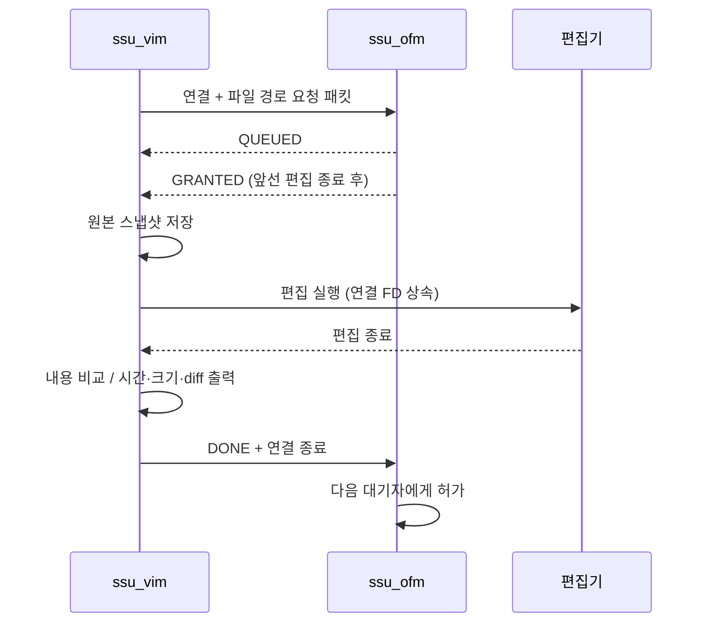

# ReaderWriter

[](https://github.com/JJH07/ReaderWriter/actions/workflows/ci.yml)

Linux에서 파일 하나에 대한 **편집 요청을 순서대로 처리**하는 C 프로그램입니다.
`ssu_ofm`이 편집 권한과 대기열을 관리하고, `ssu_vim`이 파일 읽기·편집·변경 내역 출력을 담당합니다.

읽기(`-r`)는 데몬을 거치지 않습니다. 편집끼리의 동시 실행을 제어하며, 읽기와 쓰기를 모두 상호 배제하는 일반적인 readers-writer lock은 아닙니다.

2026년 11월 정비에서는 기존 명령 옵션을 유지하면서, FIFO와 `SIGUSR1`/`SIGUSR2`로 분리되어 있던 요청 전달을 **Unix 도메인 소켓(`SOCK_SEQPACKET`)**으로 교체했습니다. 기존 바이너리와 새 바이너리는 통신 호환되지 않습니다. 자세한 수정 내용은 [리뷰 대응 내역](docs/REVIEW_FIXES.md), 내부 설계는 [통신 구조](docs/ARCHITECTURE.md)에 정리했습니다.

## 빠른 시작

Linux, C11 컴파일러(GCC 또는 Clang), GNU Make가 필요합니다. 기본 편집기는 `vim`, 변경 내역 출력에는 `diff`를 사용합니다. 테스트에는 Python 3가 필요하며 외부 Python 패키지는 없습니다.

```sh
git clone https://github.com/JJH07/ReaderWriter.git
cd ReaderWriter
make
printf 'hello\n' > example.txt
```

터미널 1에서 데몬을 포그라운드로 실행합니다.

```sh
./ssu_ofm example.txt -f -t -id
```

같은 작업 디렉터리의 터미널 2에서 읽거나 편집합니다.

```sh
./ssu_vim example.txt -r
./ssu_vim example.txt -w -t -s -d
./ssu_vim example.txt -rw
```

`-rw`는 내용을 먼저 출력하고 `yes` 또는 `no`를 묻습니다. `no` 또는 입력 EOF이면 편집 요청과 임시 파일 생성 없이 종료합니다.

편집기를 바꾸려면 실행 파일 이름 또는 경로를 지정합니다.

```sh
EDITOR=nano ./ssu_vim example.txt -w
```

`EDITOR`는 **인자 없는 실행 파일 하나**입니다. `EDITOR='vim -u NONE'`처럼 셸 명령문을 넣는 형식은 지원하지 않습니다. 필요한 경우 실행 파일 형태의 래퍼를 사용하세요. 편집기는 파일 편집이 끝날 때까지 포그라운드에 남아 있어야 합니다.

## 명령 옵션

### ssu_ofm — 관리 데몬

```text
ssu_ofm FILE [-f] [-l] [-t] [-id] [-n 1..1024]
             [-p LOG_DIRECTORY] [--socket PATH]
```

| 옵션 | 동작 |
| --- | --- |
| `FILE` | 관리할 기존 일반 파일. 실행 시 절대 경로로 정규화 |
| `-f` | 포그라운드 실행. 생략하면 백그라운드 실행 후 PID 출력 |
| `-n N` | 대기열 크기. 기본 16, 범위 1~1024. 현재 편집자 1명은 별도 |
| `-t` | 로그에 날짜·시간 포함 |
| `-id` | 요청 로그에 운영체제로 확인한 UID 추가. PID는 기본 기록 |
| `-p DIR` | 로그 저장 디렉터리. 기본 현재 디렉터리 |
| `-l` | 편집 연결이 해제될 때 로그 사본 `ssu_log.txt.<고유 접미사>` 생성 |
| `--socket PATH` | 기본 `./tmp/readerwriter.sock` 대신 사용할 소켓 경로 |
| `--help` | 사용법 출력 |

기본 로그는 `ssu_log.txt`입니다. 소켓의 부모 디렉터리와 `-p` 디렉터리는 없으면 `0700`으로 생성합니다. 그보다 상위 디렉터리는 미리 있어야 합니다. 기존 디렉터리는 실행 사용자 소유이고 소유자가 쓰기·탐색할 수 있어야 하며, 다른 사용자에게 쓰기 권한이 있으면 거절합니다.

백그라운드 실행과 종료 예시:

```sh
./ssu_ofm example.txt -t -p logs
# 출력된 pid를 사용합니다.
kill -TERM <pid>
```

포그라운드에서는 `Ctrl+C`로 종료할 수 있습니다. 종료 요청을 받으면 새 요청 처리를 중단하고 대기자에게 종료를 알립니다. 현재 편집자가 있으면 편집 연결이 해제될 때까지 기다린 뒤 소켓을 정리합니다.

### ssu_vim — 읽기·편집 클라이언트

```text
ssu_vim FILE <-r|-w|-rw> [-t] [-s] [-d]
             [--socket PATH] [--timeout 1..86400]
```

| 옵션 | 동작 |
| --- | --- |
| `-r` | 내용 출력 후 종료. 데몬 불필요 |
| `-w` | 데몬의 허가를 받은 뒤 편집 |
| `-rw` | 내용 출력 후 `yes`일 때만 편집 |
| `-t` | 수정 시간·현재 시간 및 내용 변경 여부 출력 |
| `-s` | 내용이 바뀌었을 때 편집 전후 파일 크기 출력 |
| `-d` | 내용이 바뀌었을 때 `diff -u` 출력 |
| `--socket PATH` | 데몬과 동일한 소켓 경로 지정 |
| `--timeout N` | 편집 허가 대기 한도(초). 기본 30, 범위 1~86400. 편집 시간에는 적용하지 않음 |
| `--help` | 사용법 출력 |

`-r`, `-w`, `-rw` 중 정확히 하나가 필요합니다. 성공은 종료 코드 `0`, 실행 실패는 `1`, 잘못된 옵션·확인 입력은 `2`입니다. 큐가 꽉 찼거나 대상 파일이 다르면 기다리지 않고 오류를 반환합니다.

다른 작업 디렉터리에서 접속할 때는 양쪽 모두 같은 절대 소켓 경로를 지정하세요. Linux의 Unix 소켓 경로 길이 제한도 적용됩니다.

## 동작 흐름



소켓 연결과 요청자가 연결되므로 파일명과 PID를 따로 대응시키지 않습니다. 데몬은 단일 `poll()` 루프에서 상태를 갱신하며, 시그널 핸들러는 종료 플래그만 설정합니다. 임시 스냅샷은 `$TMPDIR` 또는 `/tmp`에 `0600`으로 생성하고 정상·오류 종료 경로에서 직접 생성한 파일만 삭제합니다.

## 테스트

```sh
make test                 # 기본 컴파일러 + 통합 테스트 25개
make clean
make CC=clang test        # Clang 빌드
make sanitize            # GCC 기준 AddressSanitizer + UndefinedBehaviorSanitizer
make clean               # 생성된 실행 파일과 오브젝트 제거
```

[GitHub Actions](https://github.com/JJH07/ReaderWriter/actions/workflows/ci.yml)는 push와 PR마다 GCC·Clang의 경고 없는 빌드(`-Werror`)와 ASan/UBSan을 포함한 세 작업을 수행합니다. 테스트는 실제 Linux 프로세스·소켓·파일을 사용하며 자동 편집기 fixture로 편집 과정을 재현합니다. 검사 항목과 수동 확인 방법은 [검증 안내](docs/TESTING.md)를 참고하세요.

## 저장소 구성

| 경로 | 역할 |
| --- | --- |
| `ssu_ofm.c` | 데몬 초기화, 접속·대기열·종료 처리, 로그 |
| `ssu_vim.c` | 옵션 검증, 읽기, 허가 대기, 편집·비교·정리 |
| `rw_common.h`, `rw_common.c` | 통신 형식과 경로·입출력·숫자 검증 공통 함수 |
| `tests/test_integration.py` | 통합·회귀 테스트 |
| `.github/workflows/ci.yml` | Linux 자동 빌드 및 테스트 |
| `docs/` | 설계, 리뷰 대응표, 검증 안내 |

## 사용 범위와 제약

- Linux 전용입니다. Windows에서는 WSL 등의 Linux 환경이 필요하며 macOS는 검증 대상이 아닙니다.
- 같은 사용자, 같은 소켓을 사용하는 클라이언트끼리 편집을 조정합니다. 파일을 직접 여는 외부 프로그램이나 다른 소켓의 데몬까지 잠그지는 않습니다.
- 읽기는 편집과 동시에 가능하므로 수정 중인 내용을 볼 수 있습니다.
- 편집기는 상속된 연결 FD를 유지해야 합니다. 임의로 모든 추가 FD를 닫거나 백그라운드로 분리되는 편집기는 지원 대상이 아닙니다.
- 데몬을 `SIGKILL`로 강제 종료한 경우 기존 편집기를 먼저 종료한 뒤 재시작하세요. 실행 중인 편집 권한은 재시작한 데몬으로 복구되지 않습니다. 활성 편집이 없는 경우에는 남은 소켓을 자동 복구합니다.
- 클라이언트를 강제 종료하면 임시 스냅샷이 남을 수 있습니다. 정상 종료에서는 제거됩니다. 로그 사본은 자동 삭제·순환하지 않습니다.
- `.sock.lock` 파일은 중복 데몬 방지용으로 유지합니다. 실행 중 삭제하지 마세요. 실행 파일·로그·임시 디렉터리는 Git 추적에서 제외했습니다.

기존 FIFO·시그널 구현은 Git 이력의 [`a2dbeb7`](https://github.com/JJH07/ReaderWriter/tree/a2dbeb73c1d2b5e7a58cf536b27dd4c40497d3e0)에 보존돼 있습니다.
