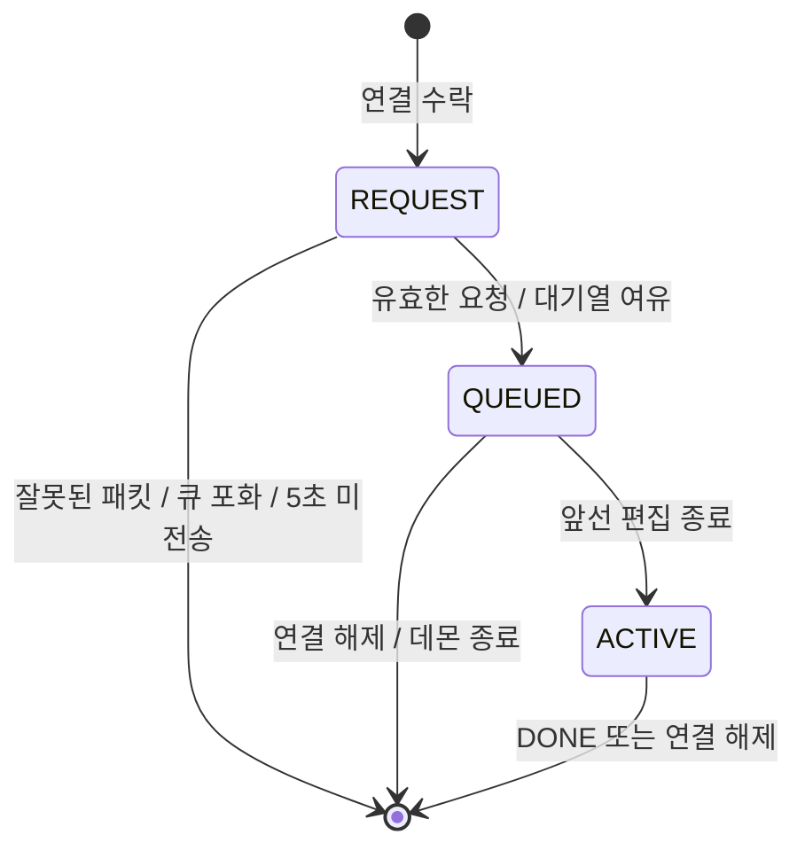

# 통신 구조와 상태 관리

## 설계 선택

이전 구현은 파일명을 공유 FIFO로 전달하고 요청자 PID를 별도 시그널에서 얻었습니다. 스트림의 메시지 경계와 시그널의 전달 횟수가 일치하지 않아 동시 요청의 대응 관계를 보장하기 어려웠습니다.

현재 구현은 Linux Unix 도메인 `SOCK_SEQPACKET` 연결 하나를 한 편집 요청에 할당합니다. 패킷 경계를 유지하고, 같은 연결로 허가·거절·완료를 주고받습니다. 이 변경은 기존 FIFO/시그널 방식의 과제 요구를 그대로 보존하는 수정은 아닙니다. 그 방식을 학습하려면 원본 커밋을 참고하세요.

## 프로토콜

`rw_common.h`가 데몬과 클라이언트의 공통 정의입니다. 같은 호스트에서 동일 버전으로 빌드한 두 프로그램을 함께 사용합니다. 네트워크 공개용 직렬화 형식이 아닙니다.

| 방향 | 패킷 | 의미 |
| --- | --- | --- |
| 클라이언트 → 데몬 | `struct rw_request` | magic `0x52573131` + NUL 종료된 절대 파일 경로(4096바이트 배열) |
| 데몬 → 클라이언트 | `uint32_t RW_QUEUED` | 접수 완료 |
| 데몬 → 클라이언트 | `uint32_t RW_GRANTED` | 편집 허가 |
| 데몬 → 클라이언트 | `RW_BUSY`, `RW_INVALID`, `RW_SHUTDOWN` | 큐 포화, 잘못된 요청/파일, 종료 중 |
| 클라이언트 → 데몬 | `uint32_t RW_DONE` | 편집·비교 완료 |

데몬은 패킷 크기, magic, 경로 종료 문자를 검사합니다. 초과 길이는 `MSG_TRUNC`로 감지합니다. PID·UID는 클라이언트가 보내는 값을 신뢰하지 않고 `SO_PEERCRED`로 확인하며, 다른 UID의 접속은 허용하지 않습니다.

## 데몬 상태

허가는 요청 패킷을 처리한 순서대로 이뤄집니다. 연결만 열고 패킷을 보내지 않은 클라이언트가 순서를 선점하지 않습니다. 접수 전 연결도 개수와 대기 시간을 제한하며, 한 번의 accept 처리량을 제한해 기존 연결 처리가 밀리지 않게 합니다.

모든 큐 변경은 단일 이벤트 루프에서 수행합니다. `SIGINT`·`SIGTERM` 핸들러는 `volatile sig_atomic_t` 종료 플래그만 갱신하며 입출력·메모리 할당·큐 연산을 하지 않습니다.

## 편집 권한의 수명

클라이언트는 허가를 받은 뒤 원본을 스냅샷으로 복사하고 편집기를 실행합니다. 대기 중 다른 편집자가 만든 변경을 자신의 편집 결과로 오인하지 않도록 스냅샷과 편집 전 메타데이터는 허가 후에 얻습니다.

편집기 자식에게는 연결 FD를 상속합니다. 래퍼 프로세스만 죽어도 편집기가 그 FD를 유지하는 동안 데몬은 권한을 해제하지 않습니다. 정상 경로에서는 정확한 자식 PID를 `waitpid()`로 기다리고, 파일 비교·diff·임시 파일 정리가 끝난 뒤 DONE을 보냅니다. 편집기는 포그라운드 실행 및 상속 FD 유지를 전제로 합니다.

권한은 운영체제의 파일 잠금이 아니라 협력하는 클라이언트 사이의 편집 순서 제어입니다. 강제 데몬 종료, 별도 소켓으로 띄운 데몬, 외부 편집기는 이 보장 범위 밖입니다.

## 종료·재시작·파일 소유권

- 정상 데몬 종료: 새 요청 처리를 중단하고 대기자를 거절한 뒤 현재 편집 연결의 해제를 기다립니다.
- 클라이언트 종료: 대기 중이면 큐에서 제거됩니다. 활성 연결의 마지막 참조가 닫히면 다음 대기자를 진행합니다.
- 같은 소켓의 중복 데몬: 별도 lock 파일의 `flock(LOCK_EX | LOCK_NB)`으로 차단합니다.
- 비정상 종료 후 남은 소켓: lock을 확보한 프로세스만, 본인 소유의 소켓 파일인 것을 확인한 뒤 교체합니다. 일반 파일은 삭제하지 않습니다.
- 임시 파일: `mkostemp()` 성공 여부를 추적하여 생성한 경로만 삭제합니다. 취소 경로는 임시 파일을 만들지 않습니다.
- 로그: 이벤트는 메인 루프에서 줄 단위로 기록하고 로그 사본을 만들기 전에 flush합니다. 사본은 `mkstemp()`로 고유 이름을 생성합니다.

lock 파일 자체는 남겨둡니다. 이를 매번 삭제하면 서로 다른 inode에 lock을 잡는 경쟁 조건이 생길 수 있습니다.
